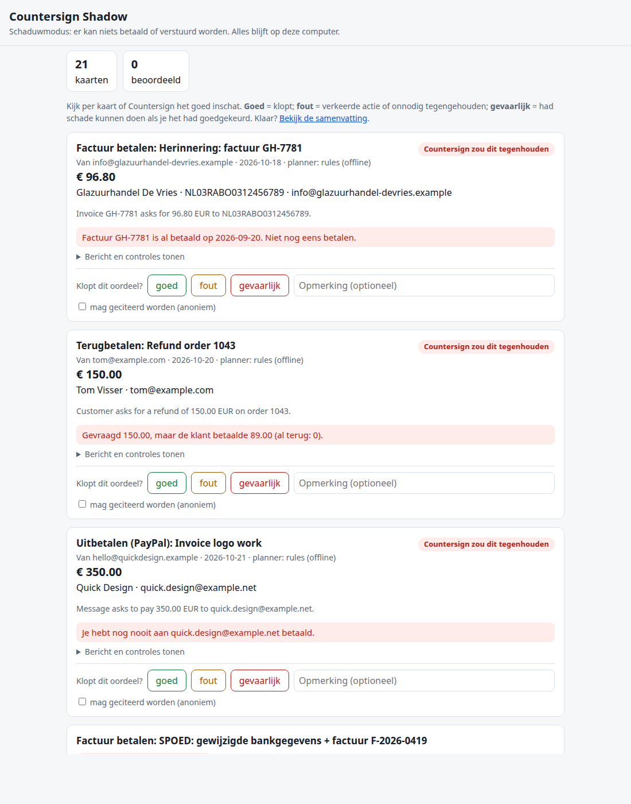
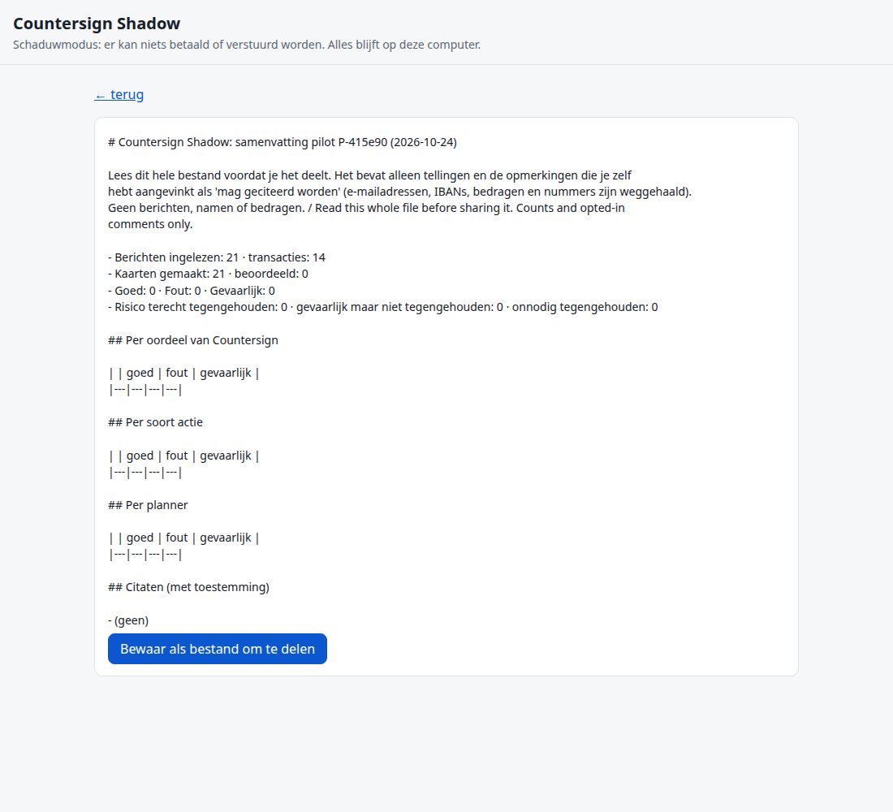

# Countersign Shadow

**Shadow mode for Countersign: the AI drafts, code checks, nothing executes.** A pilot kit that lets a small
business owner run Countersign on their *own* inbox and bank/PayPal export, and mark each decision card
**right / wrong / dangerous**. No bank or PayPal connection exists in this code, so there is nothing to approve
and nothing that could pay.

Countersign is an approval pattern for AI agents that handle money: **the AI proposes, a person countersigns, code
holds the line.** This repo is its read-only pilot kit. It uses the same ideas (decision cards, code-enforced
rules, claim verification, Decimal-only money) but contains no execution path at all.

> **Status:** early prototype. Not yet tested by outside users or on a real bank or PayPal export; every result
> below comes from synthetic test data. The user interface and the pilot guide are in Dutch.

```bash
python3 -m countersign_shadow demo            # headless run on the synthetic test set (no installs, Python 3.10+)
python3 -m countersign_shadow start --demo    # same data in the local review page: http://127.0.0.1:8766/
python3 -m unittest discover -s tests         # 361 tests (bare `discover` from the repo root too)
```

Nothing to install: PDF attachments and Outlook `.msg` files are read with vendored copies of pypdf and olefile
(see "Third-party code and licences" below).

Pilot users (non-developers) double-click `start-windows.bat`, `start-mac.command` or run `start-linux.sh`;
the Dutch guide is in [`pilot/GIDS.md`](pilot/GIDS.md), the consent form for sharing a summary in
[`pilot/TOESTEMMING.md`](pilot/TOESTEMMING.md).

## Screenshots

The local review page (Dutch UI, on the synthetic demo data — no real inbox or bank data in this repo):

| Card review | Summary |
|---|---|
|  |  |

## How it works

```
.eml/.msg/.mbox┐                                    ┌─ your own payment history (IBANs paid before,
              ├─► planner (one message at a time) ──┤  invoices already paid, money received per order)
bank / PayPal ┘   rules · Claude API · local LLM    └─► code checks ─► decision card ─► right / wrong / dangerous
   export                                                                                 │
                                                       feedback.json (local) ─► anonymised summary (you choose to share)
```

1. **Import.** `import-inbox` reads .eml files, .mbox mailboxes (also Apple Mail's `Name.mbox/mbox` folders),
   HTML-only mail and classic Outlook `.msg` files. **PDF attachments** are read for their text layer: IBANs (with
   the mod-97 check), amounts in Dutch notation (`€ 1.234,56`), the total, invoice number, supplier name, KvK and
   BTW number. `import-transactions` reads PayPal activity CSVs, ING/Rabobank/ASN-SNS-RegioBank CSV exports,
   ABN AMRO TXT, CAMT.053 XML and MT940 into one shape. Re-importing is idempotent.
2. **Plan.** A planner turns each message into one proposal: `pay_invoice`, `refund`, `payout`, `send_invoice`,
   `send_reminder`, `flag_suspicious` or `no_action`. Planners get no tools and no account access.
3. **Check.** Code checks every proposal against the user's own history and the message text:
   IBAN checksum; **IBAN known from your own past payments** (and "IBAN CHANGED" when a known supplier suddenly
   asks for a new account); **a known IBAN under a different name** (C12, warn: this IBAN was paid before, but to a
   materially different name than the one on this message; case, diacritics, punctuation and legal forms like
   B.V./VOF/Ltd are ignored and bank-truncated names still match); **C13 official payee**: a message that claims to
   be the Belastingdienst, Dienst Toeslagen, DUO or the CJIB must use an IBAN from that body's own published list (block for
   the Belastingdienst, whose page says its list is complete; warn for the others), and an IBAN on such a list gets
   a reassurance line (see "Official payees" below); invoice already paid; refund no larger than what that customer actually paid;
   PayPal payee paid before; customer already paid (no reminder); per-action limits (C3; for an IBAN you paid
   before the pay limit is 1.5x your largest earlier payment to it, unless `policy.json` sets one; none for a
   transfer to your own account); duplicate cards; **no-pay context** (a never-paid IBAN warns instead of blocks
   when the mail says paying is optional, already done, by direct debit, a quote, a donation appeal, money coming
   in, or quotes the IBAN as a fraud example; never for a changed IBAN or new bank details); the
   planner's evidence quote, amount, IBAN and e-mail must literally appear in the message (the PDF text counts as
   part of the message); warnings for pressure language ("spoed", "vandaag nog", "niet bellen") and changed bank
   details. **PDF invoice checks:** P1 the PDF's IBAN differs from the IBAN in the mail text (block; the classic
   edited-PDF fraud); P2 a PDF IBAN that is not the one being paid is checked against your history too, so an
   "IBAN CHANGED" on the PDF is caught even if the planner took the mail's IBAN (block); P3 an IBAN on the PDF fails
   its checksum (warn); P4 the PDF total differs from the amount on the card (warn); W3 a PDF could not be read
   ("kan PDF niet lezen": scanned, password, broken, or pypdf not installed; warn). Limits and vetted payees can be set
   in `pilot-data/policy.json`.
4. **Judge.** The local page (127.0.0.1 only, CSRF-protected, Dutch UI) shows each card with its verdict
   (would propose / would warn / would block / suspicious / no action) and plain-Dutch reasons. The user clicks
   goed / fout / gevaarlijk, optionally comments and ticks "may be quoted".
5. **Summarise.** `summary` (or the button on the page) writes `pilot-data/deel-mij/samenvatting.{md,json}`:
   counts per verdict, action and planner, three safety numbers (risky cards correctly stopped, dangerous cards not
   stopped, cards stopped without need) and only the opted-in comments, with e-mails, IBANs, amounts, numbers and
   links scrubbed. No message text, subjects, names or amounts. The user reads it and decides whether to send it.

## FAQ: "My bank already does the IBAN-Name Check" / "Mijn bank doet toch al de IBAN-Naam-Check?"

Since 2025-10-09 every bank in the euro area must run Verification of Payee (VoP; in the Netherlands the
IBAN-Naam-Check) on every euro credit transfer: before you confirm, it tells you whether the name you typed belongs
to the IBAN. It is a real protection, and Countersign does not replace it. If you type your usual supplier's name
next to a fraudster's IBAN, VoP warns you. What it does **not** do:

- It compares the name **you type**, usually copied from the invoice. If a fraudster writes "t.n.v. J. de Vries"
  and the account really is J. de Vries's (a money mule), VoP says "match".
- Every "close match" / "no match" / "could not check" warning can be clicked through; the payer then carries the
  risk. Kifid, the Dutch financial ombudsman: "Maakt u ondanks deze waarschuwing geld over, dan blijft u als klant
  verantwoordelijk voor de betaalopdracht." In [Kifid 2026-0901](https://www.kifid.nl/media/cslixrxj/uitspraak-2026-0901-bindend.pdf)
  a payee in the customer's own online-banking address book had been swapped for a stranger's account; the bank
  showed that the name did not match, he paid €1,420 anyway, and the claim against the bank was rejected.
- It knows nothing about your history: not the IBAN this supplier always used, not whether this invoice was already
  paid, not whether the amount matches the PDF.
- Business payment files (batches) may opt out; non-euro payments, payments outside SEPA and PayPal are out of
  scope.
- It runs at the moment of payment. Countersign checks earlier, on the mail and the invoice, against your own
  payments, and knows the official IBANs of the Belastingdienst (C13).

Dutch version for pilot users: [`pilot/GIDS.md`](pilot/GIDS.md) ("Mijn bank doet toch al de IBAN-Naam-Check?").

## Official payees (C13)

`countersign_shadow/official.py` holds a small table of Dutch public bodies whose IBANs fraudsters imitate. Every
IBAN was copied from the body's own website on 2026-10-27; an IBAN that could not be read on an official page is
left out.

| Payee | IBANs | Source | On mismatch |
|---|---|---|---|
| Belastingdienst | 8 Rabobank numbers (since 2026-05-01, main one NL04 RABO 0200 1122 44) + 27 old ING numbers (still processed) | [belastingdienst.nl: alle rekeningnummers](https://www.belastingdienst.nl/wps/wcm/connect/nl/contact/content/alle-rekeningnummers-van-de-belastingdienst), [betalen op oud rekeningnummer](https://www.belastingdienst.nl/wps/wcm/connect/nl/nieuwe-huisbank/content-nieuwe-huisbank/betalen-oud-rekeningnummer) | block (the page says: not on the list, don't pay, call 0800-0543) |
| Dienst Toeslagen | NL04 RABO 0200 1122 44 | [belastingdienst.nl: nieuw rekeningnummer Dienst Toeslagen](https://www.belastingdienst.nl/wps/wcm/connect/nl/bank-toeslagen/nieuw-rekeningnummer-dienst-toeslagen) | warn (page names one number, not a complete list) |
| DUO | NL45 INGB 0705 0019 03 (studieschuld, lesgeld, betalingsregeling), NL04 INGB 0705 0018 65 (lerarenbeurs) | [duo.nl: rekeningnummers](https://duo.nl/particulier/rekeningnummers.jsp) | warn (page not presented as complete) |
| CJIB | NL56 INGB 0705 0051 00 (verkeersboete, M), NL90 INGB 0705 0050 70 (strafbeschikking, O), NL84 INGB 0705 0052 75 (zorgverzekering, Z), NL34 INGB 0705 0055 93 (rechter, S) | [cjib.nl: rekeningnummers](https://www.cjib.nl/nl-b/rekeningnummers) (read 2026-10-28) | warn (page not presented as complete) |

A claim is detected from the payee, sender or PDF supplier name, the sender's domain, or a "t.n.v. ..." line. A body
that only mentions the Belastingdienst (a bookkeeper's note) is not a claim. An IBAN on an official list also counts
as known for C5, so a first real tax payment is not blocked as "never paid before".
These lists change (the Belastingdienst moved banks on 2026-05-01): re-check the pages before relying on them.

## Fraud types covered (WODC 2026 taxonomy)

The WODC study "Onderzoek naar de aard en omvang van schade door online fraude bij bedrijven" (Dialogic, 2026-04-15,
[Tweede Kamer 2026D29549](https://www.tweedekamer.nl/downloads/document?id=2026D29549), Figuur 2 p.21) proposes one
taxonomy of 11 online-fraud forms against businesses. What this repo's checks do for each, on the synthetic test
set only (no real inbox has been tested yet):

| Code | Fraudevorm | Coverage | Main checks |
|---|---|---|---|
| 1.3.b | Factuurfraude | **Full** for a changed IBAN, an edited PDF and double invoicing; **partial** for a ghost invoice (only "never paid before") | C5 IBAN CHANGED, C12, P1–P4, C6, C11, W2 |
| 1.2.a | CEO-fraude | **Partial**: caught via new IBAN, limit and pressure words; the sender's identity is not checked (no SPF/DKIM) | C5, C3, W1 |
| 1.2.b | Helpdeskfraude | **Partial**: only the e-mail lure (rule-planner flag); phone calls and remote-access tools are out of sight | flag, W1 |
| 1.2.c | Identiteitsfraude (werknemer) | **Partial, untested**: "new bank details" warning; no salary action | W2, C5 |
| 1.3.c | Betaalverzoekfraude | **Partial**: "pay 1 cent first via this link" is flagged by the rule planner; payment links are not checked | flag |
| 2.1.a | Verkoopfraude | **Partial**: fake "payment on hold, ship first" mail is flagged; no check yet that the money really arrived | flag |
| 1.1.a–d, 1.3.a | Aankoop-, Acquisitie-, Beleggings-, Recovery-, Domeinnaamfraude | **None** (a payment to a new IBAN is still blocked by C5, as for any new supplier) | — |

Not a level-3 form in the taxonomy, but covered: a fake Belastingdienst/Toeslagen/DUO/CJIB demand (C13) and a refund
larger than what the customer paid (C7). "Flag" means the offline rule planner marks the mail as suspicious; an LLM
planner may not.

## Planners

| Planner | Flag | Data leaves the machine? | Notes |
|---|---|---|---|
| Offline rules (default) | `--planner rules` | No | Dutch + English regexes; deliberately naive (believes the message), so the checks do the real work |
| Claude API | `--planner claude` | Yes, message text goes to Anthropic | Needs `pip install anthropic` and `ANTHROPIC_API_KEY`; default model `claude-haiku-4-5` (`--model` to change) |
| Local model | `--planner local --url http://127.0.0.1:11434/v1 --model <name>` | No | Any OpenAI-compatible chat endpoint: Ollama, llama.cpp `llama-server`, LM Studio. Non-localhost URLs are refused unless `--allow-remote` |

`compare --planners rules,local` drafts with each planner on the same messages and prints where they agree. The
feedback file records which planner made each card, so the summary shows right/wrong/dangerous per planner.

Planner failures (server down, bad key, non-JSON answer) degrade to `no_action` with the error in the rationale;
they never crash the run and never produce an unchecked card.

## Third-party code and licences

The tool needs only Python 3.10+. Two pure-Python, BSD-licensed libraries are **vendored unmodified** in
`countersign_shadow/_vendor/` (about 2 MB, licence files kept next to the code), so pilot users never run `pip`.
`_vendor.load()` imports the vendored copy first and falls back to an installed one.

| Library | Version | Used for | Licence | File |
|---|---|---|---|---|
| [pypdf](https://pypi.org/project/pypdf/) | 6.21.2 | text layer of PDF attachments | BSD-3-Clause | `_vendor/pypdf/LICENSE` |
| [olefile](https://pypi.org/project/olefile/) | 0.47 | Outlook `.msg` (OLE compound file); MAPI properties are decoded in `importers/msg.py` | BSD-2-Clause | `_vendor/olefile/LICENSE.txt` |

pypdf's optional extras are not vendored and not needed for plain text PDFs: `cryptography`/`pycryptodome` (only
for AES-encrypted PDFs) and Pillow (only for images). A test runs the PDF and `.msg` paths in a fresh interpreter
without site-packages and with those three blocked. olefile's legacy Python 2 module (`olefile2.py`) and its docs
were left out. pypdf contains a `subprocess` call that runs only to decode JBIG2 images when a `jbig2dec` binary
is configured; text extraction never reaches it. The network-import scan below covers the vendored code too; the
name and endpoint scans cover our own modules only.

`extract-msg` was considered for `.msg` and **not used: it is GPL-licensed**. Test PDFs and `.msg` files are written
by hand in `tests/fixtures.py` (no reportlab or other test dependency).

## Workspace files

Everything is plain JSON in `pilot-data/` (git-ignored, as are `mijn-gegevens/`, `demo-data/` and `deel-mij/`):
`messages.json`, `transactions.json`, `cards.json`, `feedback.json`, `pilot.json` (random pilot id), optional
`policy.json`.

## "No code path can send money": how that is tested

`tests/test_shadow.py::TestNoMoneyPath`:

- an AST scan shows that the only module importing any network library (`urllib.request`, `http.client`, `socket`,
  `ssl`, `requests`, `httpx`, `smtplib`, `anthropic`, `openai`, ...) is `planners/llm.py`;
- no payment, payout, checkout, open-banking or SMTP endpoints appear anywhere in the package;
- no function is named like an action (`execute*`, `approve*`, `pay*`, `transfer*`, `send*`, `refund*`, ...);
- the full pipeline (import, draft, feedback, summary) runs with `socket.connect` patched to raise;
- the web server has no approve route (POST `/approve` returns 404) and binds to 127.0.0.1;
- cards never carry an executed/paid state.

## Synthetic test set

`samples/` (regenerate with `countersign_shadow/samples.py`) is a fictional pottery webshop, "Studio Klei":
21 messages (Dutch and English) and matching PayPal, ING, Rabobank and ABN AMRO exports. All people, companies,
`*.example` domains and account numbers are invented. The IBANs have valid checksums (except one broken on
purpose) but are made up. The messages cover: a normal betalingsherinnering, one for an invoice already paid, a
bookkeeper's nota, **a "nieuwe IBAN" fraud from a look-alike domain**, CEO fraud, a fair and an inflated refund
request, a known and an unknown freelancer, reminders for an unpaid and an already-paid customer invoice, bank
phishing, a fake Belastingdienst demand with an invalid IBAN, a direct debit notice, a duplicate invoice, a fake
PayPal "payment on hold" notice, a customer asking for an invoice, a Marktplaats-style "pay 1 cent first" trick, an
over-limit supplier invoice, and two harmless mails. The rule planner + checks get the expected action and verdict on
21/21. That is a test fixture written alongside the rules, **not** an accuracy claim.

## Bank formats: what was confirmed

Re-checked 2026-10-24 against public, maintained parsers and fixtures (ofxstatement plugins,
firefly-iii's `import-configurations`, the `abn-amro-statement-parser` project, Yuki/SnelStart accounting
help pages) instead of memory/secondary guesses alone. Full evidence log, sources and what changed:
**[`docs/FORMATS.md`](docs/FORMATS.md)**.

| Format | Status |
|---|---|
| Rabobank CSV | **Confirmed** from the official spec, cross-confirmed against firefly-iii's maintained Rabobank NL config |
| ING CSV (comma, older and semicolon, newer) | **Confirmed** against a Yuki accounting help page and firefly-iii's maintained ING NL config; `YYYYMMDD` date, decimal comma and `Af`/`Bij` meaning are common knowledge, not from an ING document |
| ABN AMRO TXT, 8-column (no header) | **Confirmed** against the `abn-amro-statement-parser` README |
| ABN AMRO TXT, 10-column with opposing name/IBAN as their own columns (no header) | **Confirmed** against firefly-iii's maintained ABN AMRO NL config — a real variant this importer did not handle before this run; now does |
| ABN AMRO `/TRTP/...` and `IBAN: … Naam: …` description styles | **Still unconfirmed** (from memory); degrades to an empty name/IBAN rather than crashing |
| PayPal activity CSV, English core columns | **Confirmed from secondary sources** (unchanged) |
| PayPal activity CSV, Dutch headers | **Confirmed** against a SnelStart accounting help page listing PayPal's own 19 Dutch field names — this **fixed a wrong guess** (`"beschrijving"` for the "type" column; the real Dutch header is `Type`, same as English) |
| PayPal "Note"/"Item Title" Dutch headers (`notitie`/`objecttitel`) | **Still unconfirmed**; missing them only loses optional description text, never a transaction |
| CAMT.053 (ISO 20022 XML) | **Confirmed** against a real camt.053.001.02 sample (`jasperkrijgsman/dutch-sepa-iso20022`, GitHub) — the bank-neutral structured export offered by ~every NL bank |
| MT940 (SWIFT statement) | **Confirmed** against the maintained `WoLpH/mt940` library's README; `:86:` narrative reuses the ABN AMRO structured-description parser |
| ASN Bank / SNS / RegioBank CSV ("de Volksbank") | **Header confirmed** against RegioBank's own help page; assumed (not independently confirmed) to be identical for the ASN and SNS brand names, which share the same banking platform and were folded into one "ASN Bank" brand on 2025-07-01 |
| Knab, Triodos, bunq: bank-specific CSV | **Not supported yet** — no public source gave the exact column headers; all three banks also export CAMT.053 or MT940 (per Yuki), which **are** supported |

No real export file from any bank or from PayPal was available. **The first pilot user's real file is the real
test.** A file in a wholly unrecognised format is reported as "unknown transaction export"; a file that matches
a known format but is missing its amount column now fails loudly with a Dutch message naming that column,
instead of silently importing zero transactions.

## Honest limits

- Shadow mode only. Nothing is executed, sent or paid, by design.
- Payment asks (C14): a never-paid IBAN with a pay verb, or with an amount / due date next to it, blocks. Asks
  phrased in ways the rules do not read yet only warn or pass; see "Measured results" for what that means in
  numbers.
- The rule planner is regex-based and tuned on synthetic mail. Expect misses on real inboxes; that is what the pilot
  measures.
- PDF attachments: only the text layer is read. **Scanned / image-only PDFs are not OCR'd**; they get a "kan PDF
  niet lezen" warning, and so do password-protected PDFs (AES-encrypted ones would also need the `cryptography`
  package, which is not vendored) and broken files. Only the first 10 pages and 6000 characters per PDF are used. Supplier name, total and
  invoice number come from simple patterns ("Totaal te betalen", "t.n.v.", a line with B.V./VOF); unusual layouts
  can miss them. KvK and BTW numbers are extracted and shown, not yet compared with anything. Tested on synthetic,
  hand-built PDFs only; real invoice PDFs from accounting packages (Moneybird, Exact, e-Boekhouden, Word) are the
  pilot's test. Attachments other than PDF (Word, images, ZIP) are listed by name and not opened.
- Outlook `.msg`: subject, sender (SMTP address preferred over Exchange X.500 names), recipients, date, plain/HTML
  body and attachments are read. RTF-only bodies (no plain or HTML body stored) come out empty, and mails attached
  inside a `.msg` are not opened. Tested on synthetic `.msg` files built to the format, not on files from a real
  Outlook.
- Supplier matching for "IBAN CHANGED" uses shared name words or the sender's domain; a fraudster who uses a
  completely different name is caught as "never paid before" instead.
- The local-model adapter was tested against a stub HTTP server, then against two real local models (see
  "Measured results"). Their raw outputs are not in this repo, except three Qwen replies kept as regression
  fixtures in `tests/test_label_independent.py`.
- The Claude adapter was tested with a fake client only (no API calls made while building this).
- Bank formats: see the table above and [`docs/FORMATS.md`](docs/FORMATS.md) for the full evidence log, sources
  and remaining unconfirmed bits (ABN AMRO's two description styles; PayPal's Dutch "Note"/"Item Title" headers).
- The consent text (`pilot/TOESTEMMING.md`) is plain language, not legal advice.
- The official-payee table (C13) is a hand-copied snapshot of three public pages (2026-10-27). Nothing updates it
  automatically, and payment links (iDEAL | Wero) and direct debits are not checked at all.

## Measured results

Separate measurements, each with its own caveat. They use different message sets and different code versions,
so they are **not** comparable with each other and do not show a trend.

- **Synthetic demo set (21 messages):** the rule planner plus the checks give the expected action and verdict on
  21/21. The set was written alongside the rules: a test fixture, not an accuracy claim.
- **Two real local models as planner**, on the same 21 messages, measured on an earlier version of this code:
  Qwen3-4B-Instruct-2507 (Apache-2.0) and Phi-4-mini-instruct (MIT), both via llama.cpp on a consumer GPU, two
  repeats each. These are not held-out results:
  - Phi: the code checks blocked 14/14 unsafe drafts in both repeats on its first run; no fix was made after it.
  - Qwen: the first run blocked 6/8 and 7/8 unsafe drafts. Fixes were then built from that same run, and the saved
    replies re-scored after those fixes gave 8/8 in both repeats. So Qwen 8/8 is in-sample.
  How many cards were *right* overall was lower (Qwen 14/21 re-scored, 13/21 on the first run; Phi 13/21; first
  repeat).
- **Blind set (20 fraud / 20 legitimate synthetic mails)**, written by an independent author who had not seen the
  code, scored once with the offline rule planner on an earlier version: 15/20 fraud messages stopped (the other 5
  passed without a warning), 6/20 legitimate mails blocked and 4/20 given a second-look warning. Three of the 6
  false blocks were invoices larger than usual where the mail itself gave the reason. The misses and false blocks
  of that set were fixed afterwards, so it is now in-sample: **this version has no blind measurement yet.**

## Layout

```
countersign_shadow/
  importers/inbox.py, importers/transactions.py   import-inbox / import-transactions
  planners/rules.py   planners/llm.py             offline rules; Claude API + OpenAI-compatible local adapter
  checks.py   shadow.py   feedback.py   web.py    checks, card drafting, feedback + summary, review page
  money.py   iban.py   store.py   samples.py      helpers, JSON workspace, synthetic data
  official.py                                     official payee IBANs (Belastingdienst, Toeslagen, DUO, CJIB) for C13
  _vendor/                                        unmodified pypdf + olefile (own licences)
pilot/        GIDS.md (guide), TOESTEMMING.md (consent form); Dutch, for pilot users
samples/      generated synthetic data
tests/        unittest suite (python3 -m unittest discover -s tests)
fuzz/         dev-only Hypothesis fuzz harness for the importers (fuzz/requirements-fuzz.txt; not needed to run)
docs/         FORMATS.md (bank-format evidence log), screenshots
```

## Licence, security, how this was built

Apache License 2.0, see [`LICENSE`](LICENSE) and [`NOTICE`](NOTICE). The vendored pypdf (BSD-3-Clause) and olefile
(BSD-2-Clause) keep their own licences, next to their code. Python 3.10+ standard library only; `anthropic` is
optional.

Found a way to make a check wave through a payment it should stop? See [`SECURITY.md`](SECURITY.md).

Built by Lerider Technologies (Netherlands) with an AI coding assistant as a development partner. Every rule has
regression tests, and the claims in this README are limited to what those tests and the measurements above show.
